# Building a Binary Classification Decision Tree from Scratch

### A mathematical and statistical guide — every formula, every step, no code

*From the definition of impurity to cost-complexity pruning, built up one equation at a time and checked against a fully worked, hand-computable example.*

---

## How to use this document

This guide is written for someone who wants to **understand a decision tree well enough to implement one without a library** — but it deliberately contains **no code**. Every component you would need to build is specified mathematically: what goes in, what comes out, and why it works. When you later write the implementation (in any language), each function you write should map to a numbered section here.

- **Sections 1–3** set up the problem and the model.
- **Sections 4–6** derive the splitting machinery (impurity, gain, candidate splits).
- **Section 7** builds a complete tree *by hand* on a 14-patient dataset. Every number is shown.
- **Sections 8–10** formalise the growth algorithm, leaf predictions, and the statistical meaning of what the tree optimises.
- **Sections 11–13** deal with overfitting and pruning.
- **Sections 14–18** cover practical complications, complexity, evaluation, interpretation and limitations.
- **Section 19** is an implementation blueprint: a component-by-component specification and a test checklist.
- **Section 20** is a one-page formula sheet.

**Prerequisites:** basic probability (Bernoulli/binomial distributions, conditional probability), logarithms, and summation notation. Everything else is derived.

> **Convention on figures.** All diagrams and charts are in the [`figures/`](figures/) folder. Charts built from synthetic data say so in their captions; every number in the worked example comes from the 14-row table in Section 7 and can be verified with a calculator.

---

## Table of contents

1. [The binary classification problem](#1-the-binary-classification-problem)
2. [What a decision tree is](#2-what-a-decision-tree-is)
3. [Why trees are grown greedily](#3-why-trees-are-grown-greedily)
4. [Measuring node impurity](#4-measuring-node-impurity)
5. [Scoring a split](#5-scoring-a-split)
6. [Generating candidate splits for each feature type](#6-generating-candidate-splits-for-each-feature-type)
7. [Worked example: building a tree by hand](#7-worked-example-building-a-tree-by-hand)
8. [The growth algorithm, formally](#8-the-growth-algorithm-formally)
9. [Leaf predictions: from counts to probabilities to decisions](#9-leaf-predictions-from-counts-to-probabilities-to-decisions)
10. [The statistics underneath: what a tree really optimises](#10-the-statistics-underneath-what-a-tree-really-optimises)
11. [Overfitting and the bias–variance trade-off](#11-overfitting-and-the-biasvariance-trade-off)
12. [Pre-pruning: stopping early](#12-pre-pruning-stopping-early)
13. [Post-pruning: growing big, then cutting back](#13-post-pruning-growing-big-then-cutting-back)
14. [Practical complications](#14-practical-complications)
15. [Computational complexity](#15-computational-complexity)
16. [Evaluating the classifier](#16-evaluating-the-classifier)
17. [Interpreting the tree](#17-interpreting-the-tree)
18. [Limitations and where ensembles come in](#18-limitations-and-where-ensembles-come-in)
19. [Implementation blueprint (specification, not code)](#19-implementation-blueprint-specification-not-code)
20. [Formula sheet](#20-formula-sheet)
21. [Glossary](#21-glossary)
22. [References](#22-references)

---

## Notation

| Symbol | Meaning |
|---|---|
| $N$ | number of training samples |
| $d$ | number of features |
| $\mathbf{x}_i \in \mathcal{X}$ | feature vector of sample $i$; $x_{ij}$ is its $j$-th feature |
| $y_i \in \lbrace 0, 1\rbrace$ | binary label of sample $i$ (1 = "positive" class) |
| $\mathcal{D} = \lbrace(\mathbf{x}_i, y_i)\rbrace_{i=1}^{N}$ | training set |
| $t$ | a node of the tree; $S_t \subseteq \mathcal{D}$ is the set of samples reaching it |
| $n_t$ | number of samples at node $t$ |
| $n_{t0},\ n_{t1}$ | number of class-0 and class-1 samples at node $t$ ($n_{t0}+n_{t1}=n_t$) |
| $p_t = n_{t1}/n_t$ | proportion of class 1 at node $t$ |
| $t_L,\ t_R$ | left and right children of $t$ |
| $w_L = n_{t_L}/n_t$, $w_R = n_{t_R}/n_t$ | child weights ($w_L + w_R = 1$) |
| $I(\cdot)$ | a generic impurity function; $G$ = Gini, $H$ = entropy, $E$ = misclassification error |
| $\Delta I(s, t)$ | impurity decrease produced by split $s$ at node $t$ |
| $T$ | a tree; $\tilde T$ its set of leaves; $\lvert \tilde T\rvert$ the number of leaves |
| $R_m$ | the region of feature space owned by leaf $m$ |
| $\hat p_m$ | estimated $P(y=1 \mid \mathbf{x} \in R_m)$ |
| $\mathbb{1}[\cdot]$ | indicator: 1 if the condition is true, 0 otherwise |
| $\log_2$, $\ln$ | base-2 and natural logarithms ($0 \log 0 := 0$ by continuity) |

---

## 1. The binary classification problem

### 1.1 Setup

We observe $N$ labelled examples $(\mathbf{x}_i, y_i)$, assumed to be independent draws from an unknown joint distribution $P(\mathbf{x}, y)$. We want a function $f : \mathcal{X} \to \lbrace 0,1\rbrace$ (a **classifier**) or, better, a function $\hat\eta : \mathcal{X} \to [0,1]$ (a **probability estimator**) such that

$$
\hat\eta(\mathbf{x}) \approx \eta(\mathbf{x}) := P(y = 1 \mid \mathbf{x}).
$$

### 1.2 What "good" means: risk

With the 0–1 loss $\ell(y, \hat y) = \mathbb{1}[y \neq \hat y]$, the **risk** (expected error rate) of a classifier is

$$
\mathcal{R}(f) = \mathbb{E}_{(\mathbf{x},y)}\big[\mathbb{1}[f(\mathbf{x}) \neq y]\big] = P\big(f(\mathbf{x}) \neq y\big).
$$

Conditioning on $\mathbf{x}$, predicting 1 incurs expected loss $1-\eta(\mathbf{x})$ and predicting 0 incurs $\eta(\mathbf{x})$. The loss is minimised point-wise by the **Bayes classifier**

$$
f^{\star}(\mathbf{x}) = \mathbb{1}\left[\eta(\mathbf{x}) > \tfrac{1}{2}\right], \qquad \mathcal{R}(f^{\star}) = \mathbb{E}_{\mathbf{x}}\big[\min\lbrace\eta(\mathbf{x}),\,1-\eta(\mathbf{x})\rbrace\big].
$$

Every classifier — a tree included — is an attempt to approximate $\eta(\mathbf{x})$ well enough that thresholding it reproduces $f^{\star}$. We never see $\eta$; we only see $\mathcal{D}$. So we minimise the **empirical risk**

$$
\hat{\mathcal{R}}(f) = \frac{1}{N}\sum_{i=1}^{N}\mathbb{1}[f(\mathbf{x}_i) \neq y_i]
$$

over some restricted family of functions — here, the family of decision trees — and then guard against the gap between $\hat{\mathcal{R}}$ and $\mathcal{R}$ (Sections 11–13).

> **Key idea.** The expression $\min\lbrace\eta, 1-\eta\rbrace$ above is the *misclassification impurity* of Section 4. Impurity functions are not arbitrary heuristics: they are local, per-region versions of the risk we ultimately care about.

---

## 2. What a decision tree is

### 2.1 Anatomy

A decision tree is a rooted binary tree in which

- every **internal node** holds a yes/no **test** on one feature (e.g. $x_j \le \theta$ or $x_j \in A$),
- every **edge** corresponds to an outcome of its parent's test,
- every **leaf** holds a **prediction** (a class label and, ideally, a probability).

A new example is classified by starting at the root, answering the test, following the matching branch, and repeating until it reaches a leaf.

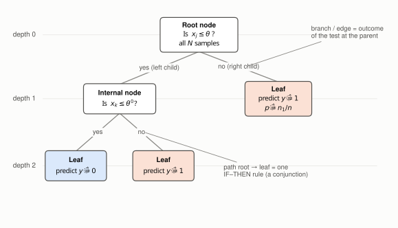

*Figure 1. Anatomy of a binary decision tree. Depth is the number of edges from the root. Every root-to-leaf path is a conjunction of tests — an IF–THEN rule.*

### 2.2 The tree as a partition of feature space

Each test splits the current region of feature space in two. A tree with $M$ leaves therefore partitions $\mathcal{X}$ into $M$ disjoint regions $R_1, \dots, R_M$ with $\bigcup_m R_m = \mathcal{X}$. Because each test involves a single feature compared against a constant, every region is an **axis-aligned (hyper-)rectangle** (for numeric features).

The model is a **piecewise-constant function**:

$$
\boxed{\;\hat\eta(\mathbf{x}) = \sum_{m=1}^{M} \hat p_m \,\mathbb{1}[\mathbf{x} \in R_m], \qquad f(\mathbf{x}) = \sum_{m=1}^{M} c_m \,\mathbb{1}[\mathbf{x} \in R_m]\;}
$$

where $\hat p_m$ is the leaf's estimated class-1 probability and $c_m \in \lbrace 0,1\rbrace$ its predicted label.

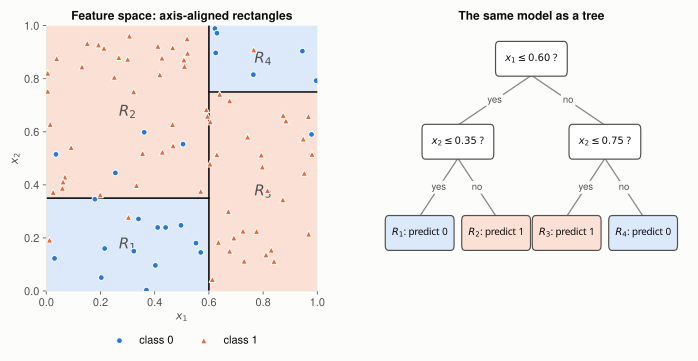

*Figure 2. Two views of the same model (synthetic data). Left: three axis-aligned cuts produce four rectangles $R_1$–$R_4$, each assigned a constant prediction. Right: the tree that encodes those cuts. Note that the second-level cut is different on each side of $x_1 = 0.6$ — a tree can model interactions.*

### 2.3 Learning a tree means learning two things

1. **The structure** — which feature and threshold to test at each node, i.e. the regions $R_m$.
2. **The leaf values** — the $\hat p_m$ (and $c_m$) inside each region.

Given the regions, the leaf values have a closed-form optimum (Section 9). All of the difficulty is in the structure.

---

## 3. Why trees are grown greedily

### 3.1 The ideal problem is intractable

The ideal would be: *find the tree with at most $M$ leaves that minimises empirical risk.* This problem is NP-complete (Hyafil & Rivest, 1976). To see the scale, count binary tree **shapes** alone: the number of distinct shapes with $M$ leaves is the Catalan number

$$
C_{M-1} = \frac{1}{M}\binom{2M-2}{M-1}, \qquad C_{9} = 4{,}862 \ \ (M = 10), \qquad C_{19} \approx 1.77 \times 10^{9}\ \ (M=20).
$$

Each of the $M-1$ internal nodes can then choose any of the $K$ available candidate splits, giving on the order of $C_{M-1}\,K^{M-1}$ labelled trees. With $K = 1{,}000$ candidate splits and $M = 10$ leaves that is about $4.9 \times 10^{30}$ trees.

### 3.2 The greedy solution: top-down induction

Every classical algorithm (Hunt's algorithm, ID3, C4.5, CART) uses the same idea, called **top-down induction of decision trees** or **recursive partitioning**:

1. At the current node, evaluate every candidate split **in isolation**.
2. Choose the one that most reduces some measure of "mixedness" (impurity) in the children.
3. Partition the data and **recurse** independently into each child.
4. Stop when a stopping rule fires; the node becomes a leaf.

This is a **greedy** (myopic, one-step look-ahead) search: it never revisits a split, and it never considers whether a split that looks poor now would enable excellent splits later. The cost of this shortcut is examined in Section 18.2; the benefit is that a tree on $N$ samples and $d$ features can be grown in roughly $O(d\,N\log N \cdot \text{depth})$ time (Section 15).

What remains is to define precisely (a) how to measure mixedness, (b) how to score a split, (c) which splits to consider, and (d) when to stop. The next three sections do (a)–(c).

---

## 4. Measuring node impurity

### 4.1 What an impurity function must satisfy

For a binary problem the class distribution at node $t$ is fully described by $p = p_t \in [0,1]$. An impurity function $\phi(p)$ should satisfy (Breiman et al., 1984):

1. **Maximal when maximally mixed:** $\phi$ attains its maximum at $p = \tfrac12$.
2. **Zero when pure:** $\phi(0) = \phi(1) = 0$.
3. **Symmetric:** $\phi(p) = \phi(1-p)$ — relabelling the classes changes nothing.
4. **Strictly concave** on $[0,1]$ — the property that makes splitting well-behaved (Section 5.2).

Three functions are in common use.

### 4.2 Misclassification error

If a node predicts its majority class, the fraction of its training samples it gets wrong is

$$
E(p) = \min(p,\ 1-p) = \tfrac12 - \left|p - \tfrac12\right|.
$$

It is the most direct measure (it *is* the local empirical risk), but it is only **piecewise linear**, not strictly concave. Section 5.2 shows why this makes it a poor splitting criterion even though it is a perfectly good pruning criterion.

### 4.3 Gini impurity

$$
G(p) = 1 - p^2 - (1-p)^2 = 2p(1-p).
$$

(For $K$ classes: $G = 1 - \sum_k p_k^2 = \sum_{k \neq k'} p_k p_{k'}$.) Gini impurity has three equivalent interpretations, each useful:

**(a) Probability of a random mismatch.** Draw a sample from the node and, independently, a label at random from the node's label distribution. The probability that the label is wrong is

$$
P(\text{mismatch}) = p(1-p) + (1-p)p = 2p(1-p) = G(p).
$$

**(b) Twice the Bernoulli variance.** If $Y \sim \text{Bernoulli}(p)$ then $\operatorname{Var}(Y) = p(1-p)$, so $G(p) = 2\operatorname{Var}(Y)$. Minimising Gini is minimising within-node variance of the 0/1 label — exactly what a regression tree does with squared error. (Section 10.2 makes this precise.)

**(c) Expected Brier score.** If the node predicts probability $p$ for every sample in it, the mean squared error (Brier score) of those predictions is

$$
\frac{1}{n_t}\sum_{i \in S_t} (y_i - p)^2 = p(1-p)^2 + (1-p)p^2 = p(1-p) = \tfrac12 G(p).
$$

Derivatives: $G'(p) = 2 - 4p$ and $G''(p) = -4 < 0$, so $G$ is strictly concave with maximum $G(\tfrac12) = \tfrac12$.

### 4.4 Entropy

From information theory, the **surprisal** of an event with probability $q$ is $-\log_2 q$ bits. The **entropy** is the expected surprisal of the label:

$$
H(p) = -p\log_2 p - (1-p)\log_2(1-p).
$$

$H(p)$ is the average number of bits needed to encode the label of a sample drawn from the node using an optimal code. A pure node needs 0 bits; a 50/50 node needs exactly 1 bit.

Derivatives: $H'(p) = \log_2\frac{1-p}{p}$ and $H''(p) = -\frac{1}{p(1-p)\ln 2} < 0$ — strictly concave, maximum $H(\tfrac12) = 1$.

**Relationship to Gini.** Measured in nats ($H_e = H \ln 2$), use the inequality $\ln q \le q - 1$, i.e. $-\ln q \ge 1 - q$:

$$
H_e(p) = p(-\ln p) + (1-p)(-\ln(1-p)) \ \ge\ p(1-p) + (1-p)p = G(p).
$$

So **Gini is the first-order Taylor approximation of entropy** (expanding $-\ln q$ around $q = 1$), and the two curves have almost the same shape once rescaled (Figure 3). In practice they choose the same split most of the time; Section 7 shows a case where they disagree on the runner-up.

### 4.5 Comparison

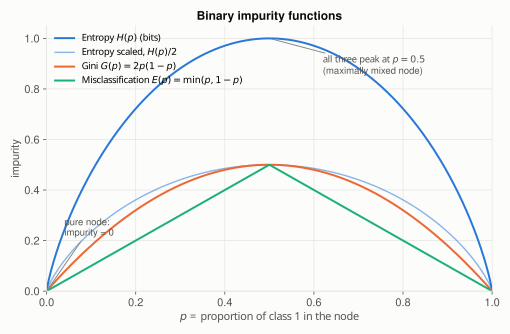

*Figure 3. The three impurity functions for a binary node. Entropy (bits) peaks at 1; Gini and misclassification error peak at 0.5. Scaled entropy $H/2$ is almost indistinguishable from Gini. Misclassification error is a "tent" — linear on each side of 0.5.*

| $p$ | $E(p)$ | $G(p)$ | $H(p)$ (bits) |
|---:|---:|---:|---:|
| 0.00 | 0.000 | 0.000 | 0.000 |
| 0.05 | 0.050 | 0.095 | 0.286 |
| 0.10 | 0.100 | 0.180 | 0.469 |
| 0.20 | 0.200 | 0.320 | 0.722 |
| 0.30 | 0.300 | 0.420 | 0.881 |
| 0.40 | 0.400 | 0.480 | 0.971 |
| 0.50 | 0.500 | 0.500 | 1.000 |

Values for $p > 0.5$ mirror these by symmetry. Note how entropy rises much more steeply near $p = 0$: entropy **penalises a small amount of contamination more heavily** than Gini does, which makes it slightly keener on splits that produce one very pure child.

---

## 5. Scoring a split

### 5.1 Impurity decrease

A split $s$ sends the $n_t$ samples at node $t$ to two children, $t_L$ (test true) and $t_R$ (test false). Its quality is the **impurity decrease**:

$$
\boxed{\;\Delta I(s, t) = I(t) - w_L\, I(t_L) - w_R\, I(t_R), \qquad w_L = \frac{n_{t_L}}{n_t},\ w_R = \frac{n_{t_R}}{n_t}\;}
$$

The children's impurities are **weighted by their share of the samples**, so a perfectly pure child containing one sample cannot buy a large gain on its own.

- With $I = H$, $\Delta I$ is called **information gain** (ID3, C4.5).
- With $I = G$, it is the **Gini decrease** or **Gini gain** (CART).

The best split at a node is $s^{\star} = \arg\max_s \Delta I(s,t)$. Since $I(t)$ is the same for every candidate at a given node, maximising $\Delta I$ is equivalent to **minimising the weighted child impurity** $w_L I(t_L) + w_R I(t_R)$.

### 5.2 Why strict concavity matters

The class proportion of the parent is the weighted average of the children's proportions:

$$
p_t = \frac{n_{t_L}p_{t_L} + n_{t_R}p_{t_R}}{n_t} = w_L\,p_{t_L} + w_R\,p_{t_R}.
$$

By **Jensen's inequality**, for any concave $\phi$,

$$
\phi(p_t) = \phi\big(w_L p_{t_L} + w_R p_{t_R}\big) \ \ge\ w_L\,\phi(p_{t_L}) + w_R\,\phi(p_{t_R}) \quad\Longrightarrow\quad \Delta I \ge 0.
$$

So **no split can ever increase impurity**. If $\phi$ is *strictly* concave, equality holds only when $p_{t_L} = p_{t_R}$ — i.e. **every split that changes the class proportions at all produces a strictly positive gain**.

Misclassification error is concave but *not strictly*: it is linear on $[0, \tfrac12]$ and on $[\tfrac12, 1]$. If both children lie on the same side of $\tfrac12$ the chord lies exactly on the curve and the gain is zero, even when the split is genuinely informative:

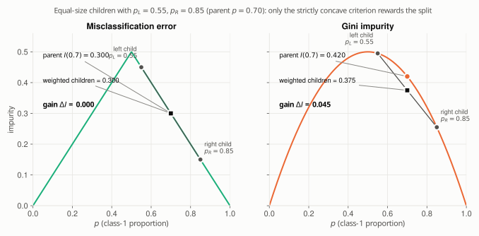

*Figure 4. A parent with $p = 0.70$ split into two equal-sized children with $p_L = 0.55$ and $p_R = 0.85$. Both children still predict class 1, so the number of training errors doesn't change and misclassification gain is exactly 0. Gini (strictly concave) sees the right child become much purer and rewards the split with $\Delta G = 0.045$. A greedy grower using $E$ would stop here and never discover the useful splits that this one enables.*

### 5.3 A closed form for the Gini decrease

For binary labels the Gini decrease simplifies beautifully. Using $G(p) = 2p - 2p^2$ and $p_t = w_L p_L + w_R p_R$ (dropping the $t$ subscripts on the children), the linear terms cancel and

$$
\Delta G = 2\left[w_L p_L^2 + w_R p_R^2 - p_t^2\right] = 2\,\big[\underbrace{w_L p_L^2 + w_R p_R^2 - (w_L p_L + w_R p_R)^2}_{\text{weighted variance of the child proportions}}\big]
$$

$$
\boxed{\;\Delta G = 2\, w_L\, w_R\, (p_L - p_R)^2\;}
$$

This one line tells you exactly what a good split looks like:

- $(p_L - p_R)^2$: the **children's class rates should differ as much as possible**;
- $w_L w_R$ (maximised at $w_L = w_R = \tfrac12$): **balanced splits are preferred** over splits that peel off a handful of samples.

### 5.4 Information gain is mutual information

Let $Z = \mathbb{1}[\text{test is true}]$ for a sample drawn from node $t$. Then

$$
\mathrm{IG}(s,t) = H(Y) - H(Y \mid Z) = \mathcal{I}(Y; Z),
$$

the **mutual information** between the label and the outcome of the test, in bits. It measures how many bits of uncertainty about $Y$ are removed by knowing which side of the split a sample falls on. Mutual information is symmetric, non-negative, and zero exactly when $Y$ and $Z$ are independent — which is the statistical content of "this split is useless".

### 5.5 Gain ratio: correcting the bias towards many-valued splits

If a categorical feature with $L$ levels is split **multi-way** (one child per level), information gain is biased towards large $L$. In the extreme, a unique patient ID column splits every sample into its own pure leaf, so $\mathrm{IG} = H(t)$, the maximum possible, while generalising not at all.

C4.5 divides by the **split information** — the entropy of the partition itself:

$$
\mathrm{SplitInfo}(s,t) = -\sum_{k} \frac{n_{t_k}}{n_t}\log_2\frac{n_{t_k}}{n_t}, \qquad \mathrm{GainRatio}(s,t) = \frac{\mathrm{IG}(s,t)}{\mathrm{SplitInfo}(s,t)}.
$$

A split into $n_t$ singletons has $\mathrm{SplitInfo} = \log_2 n_t$, heavily penalised. (C4.5 only considers splits whose IG is at least average, to avoid rewarding splits whose SplitInfo is near zero.) Section 14.4 gives numbers from the worked example. For **binary** splits — the focus of this guide — the bias is much milder, because SplitInfo $\le 1$ bit.

---

## 6. Generating candidate splits for each feature type

The search at a node is: *for each feature, enumerate its candidate splits, score each, keep the best overall.* What counts as a candidate depends on the feature type.

### 6.1 Binary features

One candidate: $x_j = 1$ vs $x_j = 0$. Once a binary feature has been used on a path, it is constant in the descendants and offers no further splits.

### 6.2 Continuous (and ordinal) features

**Candidate thresholds.** A split is $x_j \le \theta$. Only the *ordering* of the samples matters, so if the node contains $u$ distinct values $v_{(1)} < v_{(2)} < \dots < v_{(u)}$, only $u - 1$ splits are distinct. By convention the threshold is placed at the midpoint

$$
\theta_k = \frac{v_{(k)} + v_{(k+1)}}{2}, \qquad k = 1, \dots, u-1.
$$

**Efficient scan.** Sort the node's samples by $x_j$ once ($O(n_t \log n_t)$). Sweep the thresholds left to right, keeping running counts $(n_{L0}, n_{L1})$; moving one sample from right to left updates the counts in $O(1)$, and each child impurity is a function of its two counts only. Evaluating all thresholds therefore costs $O(n_t)$ after sorting.

**Only boundary points matter.** Fayyad & Irani (1992) proved that, for entropy (and the argument extends to any strictly concave impurity), the optimal threshold always lies at a **boundary point**: a midpoint between two consecutive sorted values whose classes differ. Inside a run of same-class samples the weighted child impurity is a concave function of the threshold position, so its minimum is at one end of the run. This can shrink the candidate set dramatically; Figure 6 (Section 7) shows it on real numbers.

**Ordinal features** (e.g. *Low < Medium < High*) are treated exactly like continuous ones using their rank.

### 6.3 Nominal categorical features

A nominal feature with $L$ unordered levels can be split into two non-empty groups in

$$
\frac{2^L - 2}{2} = 2^{L-1} - 1
$$

ways (e.g. 511 ways for $L = 10$, about $5 \times 10^5$ for $L = 20$). Exhaustive search is exponential.

**The ordering theorem (Fisher 1958; Breiman et al. 1984).** For a *binary* target and any concave impurity, sort the levels by their class-1 rate $\hat p(\text{level}) = n_1(\text{level})/n(\text{level})$. Then the optimal binary partition is one of the $L - 1$ **contiguous** splits of this sorted list:

$$
\lbrace \ell_{(1)}, \dots, \ell_{(k)}\rbrace \ \big|\ \lbrace \ell_{(k+1)}, \dots, \ell_{(L)}\rbrace, \qquad k = 1, \dots, L-1.
$$

**Intuition from Section 5.3.** $\Delta G = 2 w_L w_R (p_L - p_R)^2$ wants the two groups' rates to be as far apart as possible. Mixing a high-rate level into the low-rate group (while leaving a lower-rate level in the high group) can only pull the rates together — so groups should never "interleave" in the sorted order.

This reduces the work from $2^{L-1}-1$ evaluations to $L-1$ — the same as a continuous feature. Figure 7 illustrates it on the worked example.

> **Caution.** The theorem is specific to binary (or regression) targets. For three or more classes there is no such ordering shortcut in general.

### 6.4 Binary versus multi-way splits

ID3/C4.5 split nominal features **multi-way** (one child per level); CART always splits **binary**. Binary splits are preferred in this guide because they (i) fragment the data more slowly, (ii) can still represent any multi-way split as a sequence of binary ones, (iii) avoid the many-values bias of Section 5.5, and (iv) give one uniform node structure to implement.

### 6.5 How many candidates at a node?

With binary features, continuous features with $u_j$ distinct values at the node, and nominal features with $L_j$ levels present at the node, the number of candidate splits is

$$
K_t = \#\text{binary} + \sum_{j\,\in\,\text{continuous}} (u_j - 1) + \sum_{j\,\in\,\text{nominal}} (L_j - 1).
$$

---

## 7. Worked example: building a tree by hand

### 7.1 The data

A small hospital audit records 14 discharged patients. The target is **readmitted within 30 days** ($y = 1$) or not ($y = 0$). There are three features, deliberately of three different types:

- **Age** — continuous (years);
- **Diabetes** — binary (Yes/No);
- **Prior admissions** in the past year — categorical with three levels (Low / Medium / High).

| ID | Age | Diabetes | Prior admissions | Readmitted $y$ |
|---:|---:|:---:|:---:|:---:|
| 1 | 45 | No | Low | 0 |
| 2 | 52 | No | Low | 0 |
| 3 | 61 | Yes | Medium | 1 |
| 4 | 70 | Yes | High | 1 |
| 5 | 38 | No | Medium | 0 |
| 6 | 66 | No | High | 1 |
| 7 | 58 | Yes | Low | 0 |
| 8 | 73 | Yes | Medium | 1 |
| 9 | 49 | Yes | Medium | 0 |
| 10 | 68 | Yes | Low | 1 |
| 11 | 44 | No | High | 1 |
| 12 | 55 | Yes | High | 1 |
| 13 | 77 | Yes | High | 1 |
| 14 | 67 | No | Low | 0 |

Counts: $n = 14$, $n_1 = 8$ readmitted, $n_0 = 6$ not readmitted. We write node counts as $[n_0 \mid n_1]$, so the root is $[6 \mid 8]$.

We use **Gini** as the splitting criterion and report **entropy** alongside for comparison. Stopping rule: split until nodes are pure (we prune later, in Section 13).

### 7.2 Step 0 — impurity of the root

$$
p_{\text{root}} = \tfrac{8}{14} = 0.5714
$$

$$
G(\text{root}) = 1 - \left(\tfrac{6}{14}\right)^2 - \left(\tfrac{8}{14}\right)^2 = 1 - \tfrac{36}{196} - \tfrac{64}{196} = \tfrac{96}{196} = \tfrac{24}{49} = 0.4898
$$

$$
H(\text{root}) = -\tfrac{6}{14}\log_2\tfrac{6}{14} - \tfrac{8}{14}\log_2\tfrac{8}{14} = 0.4286 \times 1.2224 + 0.5714 \times 0.8074 = 0.5239 + 0.4613 = 0.9852 \text{ bits}
$$

Any split must be judged against these baselines.

### 7.3 Step 1a — candidate: Diabetes (binary feature)

| Child | Patients | Counts $[n_0 \mid n_1]$ | $p$ | Gini | Entropy |
|---|---|:---:|---:|---:|---:|
| Diabetes = Yes | 3, 4, 7, 8, 9, 10, 12, 13 | $[2 \mid 6]$ | 0.750 | $1 - 0.0625 - 0.5625 = 0.3750$ | 0.8113 |
| Diabetes = No | 1, 2, 5, 6, 11, 14 | $[4 \mid 2]$ | 0.333 | $1 - 0.4444 - 0.1111 = 0.4444$ | 0.9183 |

$$
\Delta G = 0.4898 - \left(\tfrac{8}{14}(0.3750) + \tfrac{6}{14}(0.4444)\right) = 0.4898 - (0.2143 + 0.1905) = 0.4898 - 0.4048 = \mathbf{0.0850}
$$

Check with the closed form of Section 5.3: $2 \cdot \tfrac{8}{14} \cdot \tfrac{6}{14} \cdot (0.750 - 0.333)^2 = 2 \times 0.2449 \times 0.1736 = 0.0850$. ✓

Information gain: $0.9852 - \left(\tfrac{8}{14}(0.8113) + \tfrac{6}{14}(0.9183)\right) = 0.9852 - 0.8571 = 0.1281$ bits.

### 7.4 Step 1b — candidate: Prior admissions (categorical feature)

First tabulate the class-1 rate per level, then **sort the levels by that rate** (Section 6.3):

| Level | Patients | $[n_0 \mid n_1]$ | $\hat p(\text{level})$ |
|---|---|:---:|---:|
| Low | 1, 2, 7, 10, 14 | $[4 \mid 1]$ | 0.20 |
| Medium | 3, 5, 8, 9 | $[2 \mid 2]$ | 0.50 |
| High | 4, 6, 11, 12, 13 | $[0 \mid 5]$ | 1.00 |

With $L = 3$ there are $2^{2} - 1 = 3$ possible binary groupings, but the ordering theorem says only the $L - 1 = 2$ contiguous cuts can be optimal:

**Cut A: {Low} | {Medium, High}** → children $[4 \mid 1]$ and $[2 \mid 7]$:

$$
\Delta G = 0.4898 - \left(\tfrac{5}{14}(0.3200) + \tfrac{9}{14}(0.3457)\right) = 0.4898 - 0.3365 = 0.1533
$$

**Cut B: {Low, Medium} | {High}** → children $[6 \mid 3]$ and $[0 \mid 5]$:

$$
\Delta G = 0.4898 - \left(\tfrac{9}{14}(0.4444) + \tfrac{5}{14}(0)\right) = 0.4898 - 0.2857 = \mathbf{0.2041}
$$

Closed form: $2 \cdot \tfrac{5}{14} \cdot \tfrac{9}{14} \cdot (1 - \tfrac{1}{3})^2 = 2 \times 0.2296 \times 0.4444 = 0.2041$. ✓

For completeness, the non-contiguous grouping **{Medium} | {Low, High}** gives children $[2 \mid 2]$ and $[4 \mid 6]$ and $\Delta G = 0.0041$ — as the theorem promises, it is never the best.

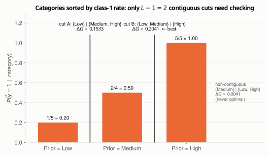

*Figure 7. Sorting the levels of a categorical feature by their class-1 rate turns a search over $2^{L-1}-1$ groupings into a scan over $L-1$ cut points, exactly like a continuous feature.*

### 7.5 Step 1c — candidate: Age (continuous feature)

Sort the 14 patients by age:

| Age | 38 | 44 | 45 | 49 | 52 | 55 | 58 | 61 | 66 | 67 | 68 | 70 | 73 | 77 |
|---|---|---|---|---|---|---|---|---|---|---|---|---|---|---|
| $y$ | 0 | 1 | 0 | 0 | 0 | 1 | 0 | 1 | 1 | 0 | 1 | 1 | 1 | 1 |

There are 14 distinct ages, hence 13 midpoint thresholds. Sweeping them left to right with running counts:

| Threshold $\theta$ | Left $[n_0 \mid n_1]$ | Right $[n_0 \mid n_1]$ | Boundary point? | $\Delta G$ | IG (bits) |
|---:|:---:|:---:|:---:|---:|---:|
| 41.0 | $[1 \mid 0]$ | $[5 \mid 8]$ | ✔ | 0.0502 | 0.0927 |
| 44.5 | $[1 \mid 1]$ | $[5 \mid 7]$ | ✔ | 0.0017 | 0.0025 |
| 47.0 | $[2 \mid 1]$ | $[4 \mid 7]$ | | 0.0309 | 0.0454 |
| 50.5 | $[3 \mid 1]$ | $[3 \mid 7]$ | | 0.0827 | 0.1239 |
| 53.5 | $[4 \mid 1]$ | $[2 \mid 7]$ | ✔ | 0.1533 | 0.2361 |
| 56.5 | $[4 \mid 2]$ | $[2 \mid 6]$ | ✔ | 0.0850 | 0.1281 |
| **59.5** | $[5 \mid 2]$ | $[1 \mid 6]$ | ✔ | **0.1633** | 0.2578 |
| 63.5 | $[5 \mid 3]$ | $[1 \mid 5]$ | | 0.1029 | 0.1613 |
| 66.5 | $[5 \mid 4]$ | $[1 \mid 4]$ | ✔ | 0.0580 | 0.0903 |
| 67.5 | $[6 \mid 4]$ | $[0 \mid 4]$ | ✔ | 0.1469 | **0.2917** |
| 69.0 | $[6 \mid 5]$ | $[0 \mid 3]$ | | 0.1002 | 0.2042 |
| 71.5 | $[6 \mid 6]$ | $[0 \mid 2]$ | | 0.0612 | 0.1281 |
| 75.0 | $[6 \mid 7]$ | $[0 \mid 1]$ | | 0.0283 | 0.0606 |

Worked arithmetic for the best Gini threshold, $\theta = 59.5$:

$$
G([5 \mid 2]) = 1 - \tfrac{25}{49} - \tfrac{4}{49} = \tfrac{20}{49} = 0.4082, \qquad G([1 \mid 6]) = 1 - \tfrac{1}{49} - \tfrac{36}{49} = \tfrac{12}{49} = 0.2449
$$

$$
\Delta G = 0.4898 - \left(\tfrac{7}{14}(0.4082) + \tfrac{7}{14}(0.2449)\right) = 0.4898 - 0.3265 = 0.1633
$$

Two observations worth pausing on:

1. **Both optima sit on boundary points** (✔), exactly as Fayyad & Irani guarantee. An implementation could have skipped the six non-boundary thresholds entirely.
2. **Gini and entropy disagree on Age.** Gini prefers $\theta = 59.5$ (a balanced 7/7 split); entropy prefers $\theta = 67.5$, which isolates a perfectly pure group of four. This is the behaviour predicted in Section 4.5: entropy is more enthusiastic about creating a pure child.

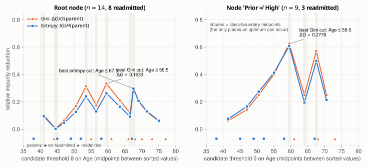

*Figure 6. Impurity reduction, as a fraction of the parent's impurity, for every Age threshold. Shaded bands mark class-boundary midpoints. Left: at the root, Gini and entropy pick different thresholds. Right: at the second-level node (Section 7.7) both agree on 59.5.*

### 7.6 Step 1d — choose the root split

| Rank | Candidate split | Children $[n_0 \mid n_1]$ | $\Delta G$ | IG (bits) |
|---:|---|---|---:|---:|
| **1** | **Prior admissions ∈ {High}** | $[0 \mid 5]$, $[6 \mid 3]$ | **0.2041** | **0.3949** |
| 2 | Age ≤ 59.5 | $[5 \mid 2]$, $[1 \mid 6]$ | 0.1633 | 0.2578 |
| 3 | Prior admissions ∈ {Low} | $[4 \mid 1]$, $[2 \mid 7]$ | 0.1533 | 0.2361 |
| 4 | Age ≤ 67.5 | $[6 \mid 4]$, $[0 \mid 4]$ | 0.1469 | 0.2917 |
| 5 | Diabetes = Yes | $[2 \mid 6]$, $[4 \mid 2]$ | 0.0850 | 0.1281 |

**Prior admissions = High** wins under both criteria. The root test is *"Is Prior admissions = High?"*

### 7.7 Step 2 — recurse into each child

**Left child (Prior = High), $[0 \mid 5]$.** Gini $= 0$: pure. **Make a leaf** predicting 1. No further search is needed.

**Right child (Prior ≠ High), $[6 \mid 3]$**, patients {1, 2, 3, 5, 7, 8, 9, 10, 14}:

$$
G = 1 - \left(\tfrac{6}{9}\right)^2 - \left(\tfrac{3}{9}\right)^2 = \tfrac{4}{9} = 0.4444, \qquad H = 0.9183 \text{ bits}.
$$

Re-run the full search **on these 9 patients only**. Ages sorted: 38(0), 45(0), 49(0), 52(0), 58(0), 61(1), 67(0), 68(1), 73(1).

| Candidate split | Children $[n_0 \mid n_1]$ | $\Delta G$ | IG (bits) |
|---|---|---:|---:|
| **Age ≤ 59.5** | $[5 \mid 0]$, $[1 \mid 3]$ | **0.2778** | **0.5577** |
| Age ≤ 67.5 | $[6 \mid 1]$, $[0 \mid 2]$ | 0.2540 | 0.4581 |
| Age ≤ 55.0 | $[4 \mid 0]$, $[2 \mid 3]$ | 0.1778 | 0.3789 |
| Diabetes = Yes | $[2 \mid 3]$, $[4 \mid 0]$ | 0.1778 | 0.3789 |
| Age ≤ 50.5 / 64.0 / 70.5 | — | 0.1111 | ≤ 0.2516 |
| Prior: {Low} vs {Medium} | $[4 \mid 1]$, $[2 \mid 2]$ | 0.0444 | 0.0728 |

Arithmetic for the winner: $\Delta G = 0.4444 - \left(\tfrac{5}{9}(0) + \tfrac{4}{9}(0.375)\right) = 0.4444 - 0.1667 = 0.2778$.

Notice that **Age**, which lost at the root, wins here. Splits are re-evaluated in each sub-population — this is how trees model **interactions**: the effect of age is only examined among patients without a high admission history.

### 7.8 Step 3 — the remaining impure node

**Age ≤ 59.5** gives a pure child $[5 \mid 0]$ (leaf, predict 0) and an impure child $[1 \mid 3]$: patients 3 (61, Yes, Medium, 1), 8 (73, Yes, Medium, 1), 10 (68, Yes, Low, 1), 14 (67, No, Low, 0).

$$
G([1 \mid 3]) = 1 - \tfrac{1}{16} - \tfrac{9}{16} = 0.375.
$$

| Candidate split | Children $[n_0 \mid n_1]$ | $\Delta G$ |
|---|---|---:|
| **Diabetes = Yes** | $[0 \mid 3]$, $[1 \mid 0]$ | **0.3750** (perfect) |
| Prior: {Medium} vs {Low} | $[0 \mid 2]$, $[1 \mid 1]$ | 0.1250 |
| Age ≤ 67.5 | $[1 \mid 1]$, $[0 \mid 2]$ | 0.1250 |
| Age ≤ 64.0 or ≤ 70.5 | — | 0.0417 |

**Diabetes = Yes** removes all remaining impurity. Both children are pure, so growth stops.

### 7.9 The finished tree

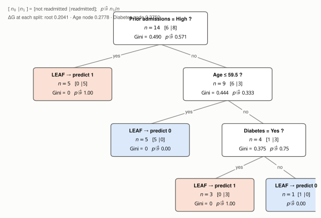

*Figure 8. The fully grown tree. Every node shows its sample count, class counts $[n_0 \mid n_1]$, Gini impurity and $\hat p = n_1/n$. It has 3 internal nodes, 4 leaves, depth 3, and classifies all 14 training patients correctly.*

Written as rules (one per leaf):

| Rule | Condition | Prediction | Support |
|---|---|:---:|:---:|
| R1 | Prior = High | readmitted | 5 / 5 |
| R2 | Prior ≠ High **and** Age ≤ 59.5 | not readmitted | 5 / 5 |
| R3 | Prior ≠ High **and** Age > 59.5 **and** Diabetes = Yes | readmitted | 3 / 3 |
| R4 | Prior ≠ High **and** Age > 59.5 **and** Diabetes = No | not readmitted | 1 / 1 |

The tree partitions the three-dimensional feature space into four regions. Because one feature is binary, the partition can be drawn as two side-by-side panels:

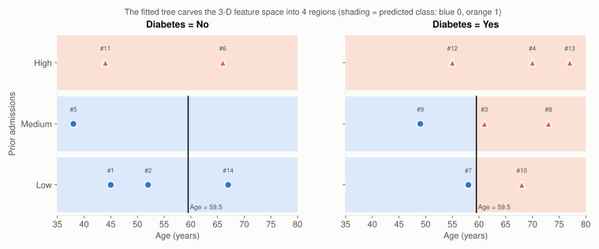

*Figure 9. The fitted partition. Each panel fixes Diabetes; the shading is the tree's prediction (blue = 0, orange = 1). The only difference between panels is the upper-right block (Prior ≠ High, Age > 59.5), which is exactly where the third split acts.*

**Predicting a new patient.** A 64-year-old without diabetes and with Medium prior admissions: Prior = High? *No* → Age ≤ 59.5? *No* → Diabetes = Yes? *No* → leaf R4: **predict not readmitted**. Note that R4 rests on a single training patient — a warning sign we return to in Sections 9.3 and 13.

### 7.10 The honest scorecard

The fully grown tree makes **0 errors on its 14 training patients**. Under **leave-one-out cross-validation** (rebuild the tree 14 times, each time predicting the one held-out patient), the same procedure makes **6 errors out of 14 (43%)** — no better than always predicting the majority class (6/14 errors). On a dataset this small the tree is memorising, not learning. Sections 11–13 explain this gap and how to close it.

---

## 8. The growth algorithm, formally

### 8.1 The recursive procedure (described in words)

**GROW(node $t$, samples $S_t$, depth $\delta$):**

1. **Record** the class counts $n_{t0}, n_{t1}$ and the impurity $I(t)$ at the node. (These are needed at every node, not only at leaves — for pruning, probability estimates and feature importance.)
2. **Check the stopping rules** (Section 12). If any fires — the node is pure; $\delta$ equals the maximum depth; $n_t$ is below the minimum split size; or no feature has two distinct values — turn $t$ into a **leaf** and return.
3. **Search.** For every feature $j$, generate its candidate splits (Section 6) and compute $\Delta I(s,t)$ for each.
4. **Select** $s^{\star} = \arg\max_s \Delta I(s,t)$. Break ties deterministically (e.g. lowest feature index, then lowest threshold) so the tree is reproducible.
5. **Validate.** If $\Delta I(s^{\star}, t)$ is below the minimum gain, or either child would have fewer than the minimum leaf size, turn $t$ into a leaf and return.
6. **Partition** $S_t$ into $S_{t_L} = \lbrace i \in S_t : \text{test}_{s^{\star}}(\mathbf{x}_i) \text{ true}\rbrace$ and $S_{t_R} = S_t \setminus S_{t_L}$. Store the test (feature index, threshold or category set) in $t$.
7. **Recurse:** GROW($t_L$, $S_{t_L}$, $\delta + 1$) and GROW($t_R$, $S_{t_R}$, $\delta + 1$).

Calling GROW(root, $\mathcal{D}$, 0) builds the whole tree.

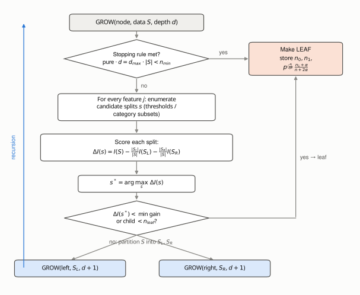

*Figure 5. The recursive growth procedure. Each call either creates a leaf or creates a test node and calls itself twice on disjoint subsets. Because the subsets shrink strictly, recursion always terminates.*

### 8.2 Termination guarantee

Each split sends at least one sample to each child (or it would not be a valid split), so $n_{t_L}, n_{t_R} < n_t$. Sample counts strictly decrease along every path, so depth is at most $N - 1$ and the tree has at most $N$ leaves.

### 8.3 Prediction

**PREDICT($\mathbf{x}$):** start at the root; at each internal node evaluate its stored test on $\mathbf{x}$ and move to the matching child; on reaching a leaf return its stored $\hat p_m$ (probability) or $c_m$ (label). Cost: one comparison per level — $O(\text{depth})$.

### 8.4 What a node must store

| Field | Internal node | Leaf |
|---|:---:|:---:|
| class counts $n_{t0}, n_{t1}$ (and weights, if any) | ✔ | ✔ |
| impurity $I(t)$ and depth | ✔ | ✔ |
| feature index $j$ and threshold $\theta$ / category set $A$ | ✔ | |
| impurity decrease $\Delta I(s^{\star}, t)$ | ✔ | |
| links to left and right children | ✔ | |
| default direction for missing values (Section 14.2) | ✔ | |
| predicted probability $\hat p_m$ and label $c_m$ | (useful for pruning) | ✔ |

---

## 9. Leaf predictions: from counts to probabilities to decisions

### 9.1 The maximum-likelihood probability

Inside leaf $m$, model the labels as i.i.d. $\text{Bernoulli}(\pi_m)$. The likelihood of the $n_m$ labels with $n_{m1}$ ones is

$$
\mathcal{L}(\pi_m) = \pi_m^{\,n_{m1}}(1-\pi_m)^{\,n_{m0}}, \qquad \ln\mathcal{L} = n_{m1}\ln\pi_m + n_{m0}\ln(1-\pi_m).
$$

Setting the derivative $\frac{n_{m1}}{\pi_m} - \frac{n_{m0}}{1-\pi_m}$ to zero gives the **MLE**

$$
\hat p_m = \frac{n_{m1}}{n_m}.
$$

### 9.2 The majority-vote label minimises training error

Predicting 1 everywhere in the leaf costs $n_{m0}$ errors; predicting 0 costs $n_{m1}$. The best constant label is therefore the majority class, $c_m = \mathbb{1}[\hat p_m > \tfrac12]$, and its error count is $n_m \min(\hat p_m, 1-\hat p_m) = n_m E(\hat p_m)$ — the misclassification impurity again.

### 9.3 Smoothing small leaves: Laplace and the Beta posterior

The MLE is overconfident in small leaves. Leaf R4 of Section 7 has $[1 \mid 0]$: the MLE claims $P(\text{readmit}) = 0$ from **one** patient.

A Bayesian fix puts a $\text{Beta}(\alpha, \beta)$ prior on $\pi_m$. Because the Beta is conjugate to the Bernoulli, the posterior is $\text{Beta}(\alpha + n_{m1},\ \beta + n_{m0})$, with posterior mean

$$
\hat p_m^{\,\text{Bayes}} = \frac{n_{m1} + \alpha}{n_m + \alpha + \beta}.
$$

- $\alpha = \beta = 1$ (uniform prior) gives the **Laplace estimate** $\frac{n_{m1}+1}{n_m+2}$.
- The **m-estimate** $\frac{n_{m1} + m\,\pi_0}{n_m + m}$ shrinks towards the overall base rate $\pi_0$ with strength $m$ — useful under class imbalance.

| Leaf | Counts | MLE $\hat p$ | Laplace $\frac{n_1+1}{n+2}$ |
|---|:---:|---:|---:|
| R1 (Prior = High) | $[0 \mid 5]$ | 1.000 | 0.857 |
| R2 (Age ≤ 59.5) | $[5 \mid 0]$ | 0.000 | 0.143 |
| R3 (Diabetes = Yes) | $[0 \mid 3]$ | 1.000 | 0.800 |
| R4 (Diabetes = No) | $[1 \mid 0]$ | 0.000 | 0.333 |

Smoothing leaves the predicted *labels* unchanged here but makes the *probabilities* honest: the tree now says it is much less sure about R4 than about R1.

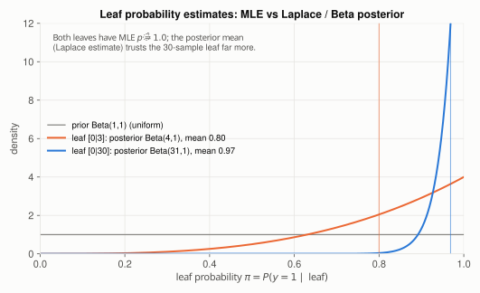

*Figure 17. Two leaves with identical MLE $\hat p = 1.0$. With a uniform prior, the 3-sample leaf's posterior (orange) is wide with mean 0.80; the 30-sample leaf's (blue) is concentrated near 1 with mean 0.97. Smoothing encodes how much evidence stands behind each leaf.*

### 9.4 From probability to decision: cost-sensitive thresholds

If a false negative (missing a readmission) costs $C_{FN}$ and a false positive (an unnecessary follow-up call) costs $C_{FP}$, the expected cost of each action at a leaf with probability $\hat p$ is

$$
\mathbb{E}[\text{cost} \mid \text{predict } 1] = (1-\hat p)\,C_{FP}, \qquad \mathbb{E}[\text{cost} \mid \text{predict } 0] = \hat p\, C_{FN}.
$$

Predict 1 when the first is smaller:

$$
\boxed{\;\text{predict } 1 \iff \hat p > \tau^{\star} = \frac{C_{FP}}{C_{FP} + C_{FN}}\;}
$$

With equal costs $\tau^{\star} = \tfrac12$ (majority vote). If missing a readmission is 4 times as costly as an extra call, $\tau^{\star} = \frac{1}{1+4} = 0.2$, and any leaf whose estimated risk exceeds 20% should be flagged. This is one reason to store probabilities rather than labels: the threshold can change after training without regrowing the tree.

---

## 10. The statistics underneath: what a tree really optimises

### 10.1 Entropy splitting is maximum-likelihood fitting

Treat the tree as a statistical model: within each leaf, labels are $\text{Bernoulli}(\pi_m)$. Plugging the MLE into the log-likelihood of leaf $m$ gives

$$
\ln\hat{\mathcal{L}}_m = n_{m1}\ln\tfrac{n_{m1}}{n_m} + n_{m0}\ln\tfrac{n_{m0}}{n_m} = -\,n_m\,H_e(\hat p_m),
$$

where $H_e$ is entropy in nats. The maximised log-likelihood of the whole tree is therefore

$$
\ln\hat{\mathcal{L}}(T) = -\sum_{m \in \tilde T} n_m\,H_e(\hat p_m).
$$

Replacing a leaf $t$ by a split into $t_L, t_R$ changes the log-likelihood by

$$
\Delta\ln\hat{\mathcal{L}} = n_t H_e(t) - n_{t_L}H_e(t_L) - n_{t_R}H_e(t_R) = n_t\,\mathrm{IG}_e(s,t) = n_t \ln 2 \cdot \mathrm{IG}(s,t).
$$

> **Choosing the split with maximum information gain is choosing the split that most increases the Bernoulli log-likelihood of the data.** Entropy-based tree growing is greedy maximum-likelihood estimation of a piecewise-constant probability model.

**Check on the worked example.** At the root, $\ln\hat{\mathcal L} = 6\ln\tfrac{6}{14} + 8\ln\tfrac{8}{14} = -9.5607$. After the root split, $\ln\hat{\mathcal L} = 0 + \big(6\ln\tfrac{6}{9} + 3\ln\tfrac{3}{9}\big) = -5.7286$. The increase, $3.8321$ nats, equals $14 \times \ln 2 \times 0.39490 = 3.8321$. ✓

The **deviance** of a tree is $D(T) = -2\ln\hat{\mathcal L}(T) = 2\sum_m n_m H_e(\hat p_m)$, and the drop in deviance caused by a split is $2 n_t \ln 2 \cdot \mathrm{IG}$.

### 10.2 Gini splitting is least-squares fitting

Encode $y \in \lbrace 0,1\rbrace$ as a number and fit each leaf with a constant. The best constant under squared error is the leaf mean $\hat p_m$, and the leaf's sum of squared errors is

$$
\mathrm{SSE}_m = \sum_{i \in R_m}(y_i - \hat p_m)^2 = n_m\,\hat p_m(1-\hat p_m) = \tfrac12\,n_m\,G(\hat p_m).
$$

Hence

$$
n_t\,\Delta G(s,t) = 2\left[\mathrm{SSE}_t - \mathrm{SSE}_{t_L} - \mathrm{SSE}_{t_R}\right].
$$

> **Choosing the split with maximum Gini decrease is choosing the split that most reduces the squared error (Brier score) of the 0/1 labels.** A Gini classification tree is a regression tree fitted to the 0/1 label.

Check: root $\mathrm{SSE} = 14 \times \tfrac{8}{14} \times \tfrac{6}{14} = 3.4286 = \tfrac12 \times 14 \times 0.4898$. ✓

### 10.3 Every split is a hypothesis test

A split cross-tabulates the label against the binary test outcome — a $2 \times 2$ contingency table. For the root split of Section 7:

| | $y = 0$ | $y = 1$ | Total |
|---|---:|---:|---:|
| Prior = High | 0 | 5 | 5 |
| Prior ≠ High | 6 | 3 | 9 |
| Total | 6 | 8 | 14 |

The null hypothesis $H_0$ is "the label is independent of the test outcome" (the split is useless). Three standard tests:

**Likelihood-ratio (G) test.** The G-statistic is exactly twice the log-likelihood gain of Section 10.1:

$$
G^2 = 2\sum_{\text{cells}} O \ln\frac{O}{E} = 2\,n_t \ln 2 \cdot \mathrm{IG}(s,t) \ \ \overset{H_0}{\sim}\ \ \chi^2_1 \ \text{(asymptotically)}.
$$

Here $G^2 = 2 \times 14 \times 0.6931 \times 0.3949 = 7.66$, $p = 0.0056$.

**Pearson's chi-squared test.** With expected counts $E_{rc} = \frac{(\text{row total})(\text{column total})}{n_t}$ — here $E = \begin{pmatrix} 2.14 & 2.86 \\ 3.86 & 5.14 \end{pmatrix}$ —

$$
\chi^2 = \sum_{\text{cells}} \frac{(O - E)^2}{E} = 5.83, \qquad p = 0.016.
$$

For binary splits there is a tidy link to Gini: $\chi^2 = n_t\,\dfrac{\Delta G}{G(t)}$, i.e. Pearson's statistic is the sample size times the *relative* Gini decrease. Check: $14 \times 0.2041/0.4898 = 5.83$. ✓

**Fisher's exact test.** With expected counts below 5, the $\chi^2$ approximations are shaky. Fisher's test computes the exact hypergeometric probability of tables at least as extreme: $p = 0.031$ (two-sided). The split is significant at the 5% level by all three tests.

Repeat at the deepest split (Diabetes, on $[1 \mid 3]$): the table is $\begin{pmatrix} 0 & 3 \\ 1 & 0\end{pmatrix}$ and Fisher's exact $p = 0.25$. **There is no statistical evidence that this split reflects anything real** — it separates one patient from three. This is the statistical signature of overfitting, and it motivates significance-based stopping (Section 12) and pruning (Section 13).

> **The multiple-comparisons trap.** The $p$-value above is for one *pre-specified* split. The tree chose the *best* of $K_t$ candidates, so the nominal $p$-value is optimistic. A Bonferroni correction multiplies it by $K_t$; CHAID-style algorithms apply such adjustments, and conditional inference trees (Hothorn et al., 2006) use permutation tests to make split selection statistically valid.

---

## 11. Overfitting and the bias–variance trade-off

### 11.1 Why training error always reaches zero

As long as no two training samples share identical features with different labels, recursive partitioning can keep splitting until every leaf is pure (Section 8.2). Training error then becomes **zero by construction** — whether or not the splits reflect real structure. The worked example showed the consequence: 0/14 training errors, 6/14 leave-one-out errors.

### 11.2 The decomposition

For squared error on the probability estimate at a fixed $\mathbf{x}$, averaging over random training sets,

$$
\mathbb{E}\big[(\hat\eta(\mathbf{x}) - \eta(\mathbf{x}))^2\big] = \underbrace{\big(\mathbb{E}[\hat\eta(\mathbf{x})] - \eta(\mathbf{x})\big)^2}_{\text{bias}^2} + \underbrace{\operatorname{Var}\big[\hat\eta(\mathbf{x})\big]}_{\text{variance}}.
$$

In a tree, both terms are governed by **leaf size**:

- **Bias** comes from averaging $\eta$ over the whole leaf region: a large leaf blurs together points with different true probabilities.
- **Variance** comes from estimating $\pi_m$ from $n_m$ samples: $\operatorname{Var}(\hat p_m) = \pi_m(1-\pi_m)/n_m$, and with $n_m = 1$ the estimate is either 0 or 1. On top of this, the *location* of the splits is itself a random function of the sample (Section 18.3).

Deeper trees ⇒ smaller leaves ⇒ lower bias, higher variance. The test error is U-shaped in depth:

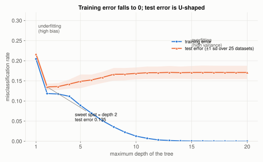

*Figure 10. Synthetic two-class "moons" data with label noise (300 training points, 4,000 test points, averaged over 25 independent datasets). Training error falls monotonically to 0. Test error is lowest around depth 2 (≈ 0.135) and climbs to ≈ 0.171 for fully grown trees. Everything right of the minimum is variance being mistaken for signal.*

There are two families of remedies: **stop early** (pre-pruning, Section 12) or **grow fully and cut back** (post-pruning, Section 13).

---

## 12. Pre-pruning: stopping early

Pre-pruning adds stopping rules to step 2 or step 5 of the growth algorithm.

| Rule | Definition | Effect and statistical meaning |
|---|---|---|
| Maximum depth $D_{\max}$ | stop when $\delta = D_{\max}$ | caps the number of leaves at $2^{D_{\max}}$ and the order of interactions at $D_{\max}$ |
| Minimum samples to split $n_{\text{split}}$ | stop if $n_t < n_{\text{split}}$ | prevents searching in nodes too small to estimate anything |
| Minimum samples per leaf $n_{\text{leaf}}$ | reject splits with a child smaller than $n_{\text{leaf}}$ | bounds leaf variance: $\operatorname{Var}(\hat p_m) \le \frac{1}{4 n_{\text{leaf}}}$ |
| Minimum impurity decrease $\gamma$ | reject if $\frac{n_t}{N}\Delta I(s^{\star},t) < \gamma$ | only keep splits that improve the *whole tree's* impurity by at least $\gamma$ |
| Maximum number of leaves | grow best-first until the budget is used | directly controls complexity $\lvert\tilde T\rvert$ |
| Significance test (CHAID-style) | reject if the (multiplicity-adjusted) $\chi^2$ / G / Fisher $p$-value exceeds a chosen significance level, e.g. 0.05 | stop when the split is statistically indistinguishable from noise |

Note the weighting in the minimum-impurity-decrease rule: $\frac{n_t}{N}\Delta I(s,t)$ is the decrease in the **sample-weighted total impurity of the tree**, $\sum_{m} \frac{n_m}{N} I(m)$. A split deep in the tree that perfectly purifies 3 samples contributes little, which is exactly right.

**The horizon problem.** Pre-pruning is cheap, but because it judges each split in isolation it can stop before a weak split that would enable strong ones. The XOR pattern of Section 18.2 is the canonical example: every individual split has near-zero gain, so any gain threshold stops at the root. Post-pruning avoids this by looking at whole subtrees after the fact.

---

## 13. Post-pruning: growing big, then cutting back

### 13.1 Reduced-error pruning (simple, needs a validation set)

Hold out a validation set. Working bottom-up, replace an internal node by a leaf (predicting its majority class) whenever doing so **does not increase** the validation error. Repeat until no replacement helps. Simple and fast, but it spends data on validation and the result depends on that particular split of the data.

### 13.2 Cost-complexity pruning (CART's weakest-link pruning)

**The objective.** For a tree $T$, let $R(T)$ be its resubstitution (training) misclassification rate, $R(T) = \sum_{m \in \tilde T} \frac{\text{errors in leaf } m}{N}$. For a complexity parameter $\alpha \ge 0$ define

$$
\boxed{\;R_\alpha(T) = R(T) + \alpha\,\lvert\tilde T\rvert\;}
$$

Each leaf "costs" $\alpha$. At $\alpha = 0$ the full tree $T_0$ is optimal; as $\alpha \to \infty$ the root alone is optimal. For every $\alpha$ there is a unique smallest subtree $T(\alpha) \subseteq T_0$ minimising $R_\alpha$ (Breiman et al., 1984).

**The weakest link.** For an internal node $t$, compare keeping its subtree $T_t$ with collapsing $t$ into a leaf. Let $R(t)$ be the error rate if $t$ were a leaf. The two options cost the same when

$$
R(t) + \alpha = R(T_t) + \alpha\,\lvert\tilde T_t\rvert \quad\Longleftrightarrow\quad \alpha = g(t) := \frac{R(t) - R(T_t)}{\lvert\tilde T_t\rvert - 1}.
$$

$g(t)$ is the **increase in training error per leaf removed** — the price of simplicity at that node. The node with the smallest $g(t)$ is the *weakest link*: it buys the least accuracy per leaf.

**The algorithm.**

1. Start with $T_0$ and $\alpha_0 = 0$.
2. Compute $g(t)$ for every internal node of the current tree.
3. Let $\alpha_{k+1} = \min_t g(t)$; collapse every node attaining the minimum to get $T_{k+1}$.
4. Repeat until only the root remains.

**Theorem.** This produces a **nested** sequence $T_0 \supset T_1 \supset \dots \supset \lbrace\text{root}\rbrace$ with thresholds $0 = \alpha_0 < \alpha_1 < \dots$ such that $T_k$ is the optimal subtree for all $\alpha \in [\alpha_k, \alpha_{k+1})$. So instead of a continuum of $\alpha$ values there are only a handful of candidate trees.

**Worked example.** Apply it to the tree of Figure 8 ($N = 14$). Call the three internal nodes Root, $A$ (the Age ≤ 59.5 node) and $B$ (the Diabetes node).

*Round 1* (tree $T_0$, 4 leaves, $R(T_0) = 0$):

| Node | Counts | $R(t)$ as a leaf | $R(T_t)$ | Leaves in $T_t$ | $g(t)$ |
|---|:---:|---:|---:|---:|---:|
| $B$ | $[1 \mid 3]$ | 1/14 | 0 | 2 | $\frac{1/14 - 0}{1} = 0.0714$ ← min |
| $A$ | $[6 \mid 3]$ | 3/14 | 0 | 3 | $\frac{3/14}{2} = 0.1071$ |
| Root | $[6 \mid 8]$ | 6/14 | 0 | 4 | $\frac{6/14}{3} = 0.1429$ |

Collapse $B$ ⇒ $T_1$ (3 leaves, $R = 1/14$), $\alpha_1 = 1/14$.

*Round 2:* $g(A) = \frac{3/14 - 1/14}{2 - 1} = 0.1429$, $g(\text{Root}) = \frac{6/14 - 1/14}{3 - 1} = 0.1786$. Collapse $A$ ⇒ $T_2$ (2 leaves, $R = 3/14$), $\alpha_2 = 1/7$.

*Round 3:* $g(\text{Root}) = \frac{6/14 - 3/14}{1} = 0.2143$. Collapse ⇒ $T_3$ = root only, $\alpha_3 = 3/14$.

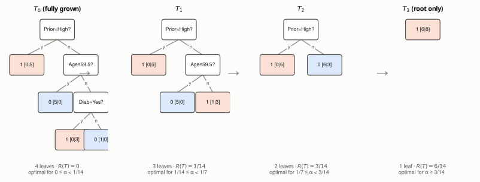

*Figure 12. The weakest-link sequence for the worked example. The first leaf to go is the one whose split rested on a single patient — the same split that Fisher's test (Section 10.3) found unsupported ($p = 0.25$).*

**Choosing $\alpha$: cross-validation and the 1-SE rule.**

1. Compute the sequence $\alpha_0 < \alpha_1 < \dots$ on the full training data. Use the geometric means $\alpha'_k = \sqrt{\alpha_k\alpha_{k+1}}$ as representative values.
2. Split the data into $V$ folds (typically $V = 10$). For each fold $v$, grow a full tree on the other $V-1$ folds, prune it at each $\alpha'_k$, and record its error on fold $v$.
3. Average to get $\widehat{\mathrm{CV}}(\alpha'_k)$ and its standard error $\widehat{\mathrm{SE}}_k = \mathrm{sd}_v / \sqrt{V}$.
4. Either pick $\alpha'$ minimising $\widehat{\mathrm{CV}}$, or — CART's recommendation — use the **1-SE rule**: pick the **largest** $\alpha'$ (smallest tree) whose CV error is within one standard error of the minimum.

The 1-SE rule reflects that CV estimates are noisy: trees within one SE of the best are statistically indistinguishable from it, so prefer the simplest.

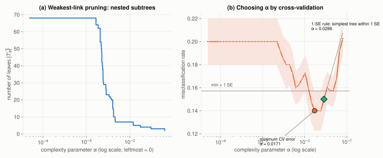

*Figure 11. Cost-complexity pruning on synthetic data (400 training points). (a) The fully grown tree has 68 leaves; as α increases, whole subtrees are removed in nested steps. (b) 10-fold CV error: the minimum (≈ 0.140) is at α ≈ 0.017 with 5 leaves; the 1-SE rule picks α ≈ 0.029 with only 4 leaves and CV error 0.150 — statistically equivalent and simpler.*

### 13.3 Pessimistic error pruning (C4.5, no validation set)

C4.5 avoids holding out data by **inflating** the training error of each leaf to an upper confidence bound. With $e$ errors among $n$ samples, $f = e/n$, and $z$ the normal quantile for confidence level CF (default CF = 25%, $z = 0.674$), the Wilson-style upper bound is

$$
U_{CF}(e, n) = \frac{f + \frac{z^2}{2n} + z\sqrt{\frac{f}{n} - \frac{f^2}{n} + \frac{z^2}{4n^2}}}{1 + \frac{z^2}{n}}.
$$

The pessimistic number of errors of a leaf is $n \cdot U_{CF}(e,n)$. A subtree is replaced by a leaf if the leaf's pessimistic error is no larger than the sum of its leaves' pessimistic errors.

*Worked example, node $B$* $[1 \mid 3]$:

- As a leaf: $e = 1, n = 4$: $U = 0.416$, pessimistic errors $= 4 \times 0.416 = 1.665$.
- As a subtree: leaf $[0 \mid 3]$ gives $3 \times 0.132 = 0.395$; leaf $[1 \mid 0]$ gives $1 \times 0.313 = 0.313$; total $0.708$.

Since $0.708 < 1.665$, C4.5 **keeps** this split (and, by the same calculation, every other split of this tree). Pure leaves are rewarded heavily, and the bound is a heuristic rather than a valid confidence interval — the leaves are not independent of the data that chose them. On tiny datasets, CV-based cost-complexity pruning or significance tests are more conservative.

### 13.4 Which pruning method?

| Method | Needs held-out data? | Statistical basis | Typical behaviour |
|---|:---:|---|---|
| Pre-pruning (depth, leaf size) | tune by CV | none / variance bound | fast; risk of stopping too early |
| Significance stopping | no | $\chi^2$ / G / Fisher tests | principled; needs multiple-testing correction |
| Reduced-error | yes | validation error | simple; wastes data |
| Cost-complexity + CV | via CV | penalised risk, model selection | the standard; nested trees, 1-SE rule |
| Pessimistic (C4.5) | no | binomial upper bound (heuristic) | cheap; tends to prune little |

---

## 14. Practical complications

### 14.1 Class imbalance

If positives are rare (say 2%), a tree can reach 98% accuracy with a single leaf. Impurity at the root is small, so splits that isolate the rare class gain little. Two equivalent remedies:

**Class weights.** Give each class-$k$ sample weight $\omega_k$ and replace every count by a weighted count: $\tilde n_{t k} = \omega_k n_{tk}$, $\tilde p_t = \frac{\omega_1 n_{t1}}{\omega_0 n_{t0} + \omega_1 n_{t1}}$, and weights $\tilde w_L = \frac{\tilde n_{t_L}}{\tilde n_t}$. The common "balanced" choice is $\omega_k = \frac{N}{2N_k}$, which makes both classes contribute equal total weight.

**Altered priors / costs.** Weighting by $\omega_1/\omega_0 = C_{FN}/C_{FP}$ is equivalent to growing the tree under misclassification costs.

Weighting changes the leaf probabilities: the weighted $\tilde p_m$ estimates $P(y=1 \mid R_m)$ **under the reweighted distribution**. To recover calibrated probabilities on the original scale, invert the reweighting (Bayes' rule with the original priors):

$$
\hat p_m = \frac{\tilde p_m/\omega_1}{\tilde p_m/\omega_1 + (1-\tilde p_m)/\omega_0}.
$$

### 14.2 Missing values

Three standard strategies:

1. **Missing-as-a-direction.** At each split, try sending all samples with $x_j$ missing to the left, then to the right; keep whichever gives the larger $\Delta I$ and store it as the node's default direction.
2. **Surrogate splits (CART).** After choosing the primary split $s^{\star}$ on feature $j$, find for every other feature $j'$ the split $s'$ that best **mimics** it. If $\pi_L, \pi_R$ are the fractions the primary split sends left and right, the predictive measure of association is
$$
\lambda(s^{\star}, s') = \frac{\min(\pi_L, \pi_R) - \big(1 - P(s' \text{ agrees with } s^{\star})\big)}{\min(\pi_L, \pi_R)}.
$$
Only surrogates with $\lambda > 0$ beat the naïve rule "send everything to the larger child". At prediction time, if $x_j$ is missing, use the best available surrogate.
3. **Fractional samples (C4.5).** Compute $\Delta I$ on the samples with $x_j$ observed and scale it by the observed fraction. At partition time, send a sample with $x_j$ missing down **both** branches with weights $w_L$ and $w_R$; at prediction, average the leaf distributions it reaches with those weights.

### 14.3 No feature scaling needed: invariance to monotone transforms

Let $h$ be any strictly increasing function. Then $x_j \le \theta \iff h(x_j) \le h(\theta)$, so the partition produced by every candidate split — and therefore every $\Delta I$, every chosen split, and every prediction — is unchanged if $x_j$ is replaced by $h(x_j)$. Standardisation, log transforms and rank transforms are all irrelevant to the fitted tree (only the stored threshold values change). Outliers in $x$ are harmless: they only affect the threshold placement between neighbours.

### 14.4 The bias towards many-valued features, in numbers

Return to the worked example's root ($H = 0.9852$ bits):

| Split | IG (bits) | SplitInfo (bits) | Gain ratio |
|---|---:|---:|---:|
| Prior: 3-way (Low / Medium / High) | 0.4417 | 1.5774 | 0.2800 |
| Prior: binary {High} vs rest | 0.3949 | 0.9403 | **0.4200** |
| Age ≤ 67.5 | 0.2917 | 0.8631 | 0.3380 |
| Age ≤ 59.5 | 0.2578 | 1.0000 | 0.2578 |
| Patient ID (14-way) | **0.9852** | 3.8074 | 0.2588 |

Raw information gain would choose the **patient ID** — a useless identifier — because a 14-way split memorises every label. The multi-way Prior split also beats the binary one on IG. Gain ratio removes both artefacts. With binary splits only, the ID column could still be split by its (meaningless) numeric order, which is one more reason to drop identifiers before training.

The same bias affects **feature importance** (Section 17.2): continuous and high-cardinality features have more candidate splits, so by chance alone they find larger apparent gains (Strobl et al., 2007).

---

## 15. Computational complexity

Let $N$ be the number of samples, $d$ the number of features, $D$ the final depth.

**Split search at one node.** For each continuous feature: sort ($O(n_t\log n_t)$), then a linear scan ($O(n_t)$). For each categorical feature with $L$ levels: count per level ($O(n_t)$), sort levels ($O(L\log L)$), scan ($O(L)$). Total per node: $O(d\,n_t \log n_t)$.

**Whole tree.** The nodes at any one depth hold disjoint subsets of the data, so the work per level is at most $O(d\,N\log N)$, and

$$
\text{training time} = O(d\,N\log N \cdot D).
$$

**Pre-sorting.** Sorting each feature once at the root ($O(dN\log N)$) and maintaining sorted index lists as samples are partitioned reduces each level to $O(dN)$, giving $O(dN\log N + dND)$.

**Depth.** A balanced tree has $D \approx \log_2 N$, so training is $O(dN\log^2 N)$ (or $O(dN\log N)$ with pre-sorting). A degenerate tree that peels off one sample per split has $D = N - 1$, and training becomes $O(dN^2\log N)$ — another reason to set $n_{\text{leaf}}$ or $D_{\max}$.

**Prediction:** $O(D)$ per sample. **Memory:** $O(\lvert\tilde T\rvert)$ nodes, at most $2N - 1$.

**Cost-complexity pruning** adds $O(\lvert\tilde T\rvert^2)$ in the simple implementation (recompute $g(t)$ each round), plus $V$ extra tree fits for cross-validation.

---

## 16. Evaluating the classifier

### 16.1 Never evaluate on the training data

Resubstitution error is optimistically biased (zero for a full tree). Use a held-out test set, $V$-fold cross-validation, or — for very small data — leave-one-out. Whatever data is used to *choose* $\alpha$ or depth cannot also be used to *report* final performance; use nested cross-validation or a final untouched test set.

### 16.2 Threshold-based metrics

From the confusion matrix (TP, FP, TN, FN) at a chosen threshold $\tau$:

| Metric | Formula | Question answered |
|---|---|---|
| Accuracy | $\frac{TP + TN}{TP+FP+TN+FN}$ | how often is it right? (misleading under imbalance) |
| Sensitivity / recall / TPR | $\frac{TP}{TP + FN}$ | of the true positives, how many are caught? |
| Specificity / TNR | $\frac{TN}{TN + FP}$ | of the true negatives, how many are cleared? |
| Precision / PPV | $\frac{TP}{TP + FP}$ | of those flagged, how many are truly positive? |
| $F_1$ | $\frac{2\cdot\text{precision}\cdot\text{recall}}{\text{precision} + \text{recall}}$ | harmonic balance of the two |
| Balanced accuracy | $\frac{1}{2}(\text{TPR} + \text{TNR})$ | accuracy that ignores class proportions |

### 16.3 ROC curves and AUC from a tree

A tree outputs one of at most $\lvert\tilde T\rvert$ distinct probabilities. Sorting the leaves by $\hat p_m$ and lowering the threshold past each one in turn traces an ROC curve with at most $\lvert\tilde T\rvert + 1$ vertices joined by straight segments. Each segment corresponds to one leaf; its slope is the leaf's likelihood ratio $\frac{n_{m1}/N_1}{n_{m0}/N_0}$, so sorting by $\hat p_m$ (equivalently by slope) makes the training ROC curve concave.

The area under the curve has a direct probabilistic meaning (the Mann–Whitney identity):

$$
\mathrm{AUC} = P\big(\hat p(\mathbf{x}^{+}) > \hat p(\mathbf{x}^{-})\big) + \tfrac12 P\big(\hat p(\mathbf{x}^{+}) = \hat p(\mathbf{x}^{-})\big),
$$

for a random positive $\mathbf{x}^{+}$ and random negative $\mathbf{x}^{-}$. Ties — common with few leaves — count half.

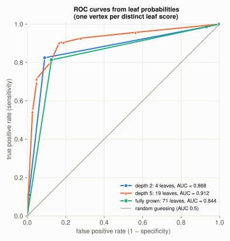

*Figure 15. Test-set ROC curves (synthetic data; 500 training, 3,000 test points). The depth-2 tree has 4 leaves and therefore only a few vertices. The depth-5 tree (19 leaves) ranks best (AUC 0.912). The fully grown tree (71 leaves) has nearly all leaves pure, so its scores are almost all 0 or 1: it collapses towards a single operating point and its AUC drops to 0.844.*

### 16.4 Probability quality: Brier score, log-loss and calibration

- **Brier score** $= \frac{1}{N}\sum_i (y_i - \hat p(\mathbf{x}_i))^2$ — the criterion Gini splitting optimises in-sample (Section 10.2).
- **Log-loss** $= -\frac{1}{N}\sum_i \big[y_i\ln\hat p(\mathbf{x}_i) + (1-y_i)\ln(1-\hat p(\mathbf{x}_i))\big]$ — the criterion entropy splitting optimises in-sample (Section 10.1). A single test sample landing in a pure leaf of the wrong class gives **infinite** log-loss — another reason for Laplace smoothing (Section 9.3).
- **Calibration**: among all samples given $\hat p \approx 0.3$, about 30% should be positive. Plot observed positive rate against predicted probability in bins. Deep trees are typically **over-confident** (probabilities pushed to 0 and 1); smoothing and pruning both help.

---

## 17. Interpreting the tree

### 17.1 Rules

Each leaf is a conjunction of conditions (Section 7.9). Rules can be simplified: conditions that become redundant along a path (e.g. "Age > 50 and Age > 59.5") collapse to the tighter one, and C4.5's *rule post-pruning* drops conditions whose removal does not raise the pessimistic error.

### 17.2 Mean decrease in impurity (MDI) feature importance

The importance of feature $j$ is the total, sample-weighted impurity decrease of all splits that use it:

$$
\mathrm{Imp}(j) = \sum_{t \,:\, \text{split on } j} \frac{n_t}{N}\,\Delta I(s_t, t), \qquad \text{usually normalised so that } \sum_j \mathrm{Imp}(j) = 1.
$$

A neat identity: summing over all splits telescopes, so

$$
\sum_j \mathrm{Imp}(j) = I(\text{root}) - \sum_{m \in \tilde T}\frac{n_m}{N} I(m).
$$

For a tree with pure leaves, the importances sum to the root impurity.

**Worked example (Gini):**

| Feature | Split(s) | $\frac{n_t}{N}\Delta G$ | Normalised |
|---|---|---|---:|
| Prior admissions | root | $\frac{14}{14} \times 0.2041 = 0.2041$ | 41.7% |
| Age | node $A$ | $\frac{9}{14} \times 0.2778 = 0.1786$ | 36.5% |
| Diabetes | node $B$ | $\frac{4}{14} \times 0.3750 = 0.1071$ | 21.9% |
| **Total** | | $0.4898 = G(\text{root})$ ✓ | 100% |

Caveats: MDI is computed on training data (so it rewards overfitted splits), is biased towards features with many candidate splits (Section 14.4), and splits credit arbitrarily between correlated features. **Permutation importance** — the increase in held-out error when feature $j$'s values are randomly shuffled — is a less biased alternative.

### 17.3 Interactions are explicit

A path that tests Prior, then Age, then Diabetes encodes a three-way interaction: the effect of Diabetes is only examined for patients with Prior ≠ High and Age > 59.5. Unlike a linear model, a tree does not need interaction terms specified in advance — but it also cannot represent a simple additive effect compactly (Section 18.1).

---

## 18. Limitations and where ensembles come in

### 18.1 Axis-aligned boundaries

Each split is perpendicular to one feature axis. A diagonal boundary such as $x_2 = x_1$ can only be approximated by a staircase, and an accurate staircase needs many leaves — each estimated from few samples.

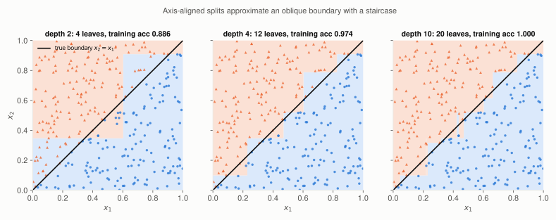

*Figure 13. Synthetic data whose true boundary is the diagonal $x_2 = x_1$. Depth 2 (4 leaves) is crude; depth 10 (20 leaves) fits the training data perfectly but with a jagged, data-dependent staircase. A linear model would need one parameter for what the tree needs 20 leaves for. (Oblique trees, which split on $\mathbf{a}^\top\mathbf{x} \le \theta$, address this at much higher search cost.)*

### 18.2 Greedy myopia: the XOR problem

When the label depends on an interaction with no marginal effect, every single split looks useless:

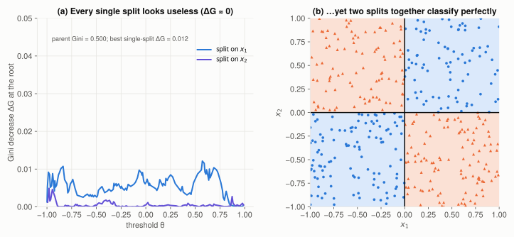

*Figure 14. XOR data: $y = 1$ when exactly one of $x_1, x_2$ is positive (400 synthetic points). (a) At the root, the best single split reduces Gini by only 0.012 out of 0.5 — indistinguishable from noise, so any reasonable gain threshold stops immediately. (b) Yet splitting at $x_1 = 0$ and then at $x_2 = 0$ classifies perfectly. A one-step look-ahead cannot see this.*

Mathematically: for XOR, $P(y = 1 \mid x_1) = P(y=1 \mid x_2) = \tfrac12$ for every value, so $p_L = p_R$ in expectation and $\Delta G = 2w_Lw_R(p_L - p_R)^2 \approx 0$ for every split (Section 5.3). Growing fully and post-pruning (Section 13) handles this better than pre-pruning, because the second-level splits have large gains that justify keeping the weak first split.

### 18.3 Instability (high variance)

Small changes in the data can change the root split, and every split below it changes too.

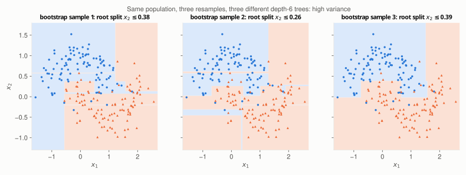

*Figure 16. Three bootstrap resamples of the same 200 synthetic points, each fitted with a depth-6 tree. The root thresholds (0.38, 0.26, 0.39) and the resulting decision regions differ visibly — the model's structure is a high-variance function of the sample.*

### 18.4 Other limitations

- **Piecewise-constant probabilities**: $\hat\eta$ takes at most $\lvert\tilde T\rvert$ values, so ranking and calibration are coarse.
- **No extrapolation**: beyond the range of the training data, predictions are constant at the edge leaf's value.
- **Data fragmentation**: each split roughly halves the data available below it; at depth 10 a typical leaf sees $N/2^{10}$ samples.

### 18.5 Ensembles turn the weakness into a strength

The variance of an average of $B$ identically distributed predictors, each with variance $\sigma^2$ and pairwise correlation $\rho$, is

$$
\operatorname{Var}\left(\frac{1}{B}\sum_{b=1}^{B}\hat\eta_b(\mathbf{x})\right) = \rho\,\sigma^2 + \frac{1-\rho}{B}\,\sigma^2.
$$

Deep trees have low bias and high variance — ideal raw material for averaging:

- **Bagging** (Breiman, 1996): average trees grown on bootstrap samples; the second term shrinks as $B$ grows.
- **Random forests** (Breiman, 2001): additionally pick a random subset of features at each split, lowering $\rho$ and therefore the first term.
- **Gradient boosting**: fit shallow trees sequentially to the residuals (gradients) of the current ensemble, reducing bias instead.

Every one of these uses the single-tree machinery of this guide as its building block, so a correct from-scratch tree is the foundation for all of them.

---

## 19. Implementation blueprint (specification, not code)

This section specifies each component you would write, with its inputs, outputs and the mathematical invariants to test. It is language-independent.

### 19.1 Components

| # | Component | Input | Output | Defined in |
|---|---|---|---|---|
| C1 | **Data schema** | raw table | feature types (binary / continuous / ordinal / nominal), category lists, label vector in $\lbrace 0,1\rbrace$ | §6 |
| C2 | **Impurity function** | counts $(n_0, n_1)$, optionally weighted | $G$, $H$ or $E$ | §4 |
| C3 | **Split scorer** | parent counts, left counts | $\Delta I$ (right counts = parent − left) | §5.1 |
| C4 | **Continuous split finder** | values and labels at node | best $(\theta, \Delta I)$ via sort + running counts; midpoint thresholds; skip equal values | §6.2 |
| C5 | **Categorical split finder** | levels and labels at node | best category set $A$ via sort-by-rate + contiguous scan | §6.3 |
| C6 | **Best-split selector** | node samples, feature list | $(j^{\star}, \text{test}^{\star}, \Delta I^{\star})$ with deterministic tie-breaking | §8.1 |
| C7 | **Node record** | — | fields of §8.4 | §8.4 |
| C8 | **Recursive grower** | samples, depth, hyperparameters | subtree | §8.1, §12 |
| C9 | **Leaf estimator** | leaf counts, smoothing $\alpha, \beta$ | $\hat p_m$, $c_m$ | §9 |
| C10 | **Predictor** | tree, $\mathbf{x}$, threshold $\tau$ | $\hat p(\mathbf{x})$ and label | §8.3, §9.4 |
| C11 | **Pruner** | full tree, (validation data or CV folds) | $\alpha$-sequence and selected subtree | §13 |
| C12 | **Evaluator** | labels, scores | confusion matrix, metrics, ROC/AUC, Brier, calibration table | §16 |
| C13 | **Interpreter** | tree | rule list, MDI importances | §17 |

### 19.2 Hyperparameters to expose

Criterion (Gini / entropy), $D_{\max}$, $n_{\text{split}}$, $n_{\text{leaf}}$, minimum impurity decrease $\gamma$, maximum leaves, class weights $\omega_0, \omega_1$, leaf smoothing $(\alpha, \beta)$, pruning $\alpha$ (or "select by CV with 1-SE rule"), decision threshold $\tau$, missing-value strategy, random seed (only if features are sampled, e.g. for forests).

### 19.3 Verification checklist

Each item is a property that must hold mathematically; together they catch nearly every implementation bug.

1. **Impurity values:** $G(0)=G(1)=0$, $G(\tfrac12)=\tfrac12$; $H(\tfrac12)=1$; symmetry $I(p) = I(1-p)$.
2. **Non-negative gain:** every computed $\Delta G$ and IG is $\ge 0$ (up to rounding); a split with $p_L = p_R$ gives exactly 0.
3. **Closed form:** $\Delta G = 2w_Lw_R(p_L - p_R)^2$ agrees with the generic formula on every candidate.
4. **Pure input:** a dataset with one class produces a single leaf.
5. **Separable input:** when no two identical feature vectors carry different labels, the fully grown tree has zero training error.
6. **Counts conserve:** at every node $n_t = n_{t_L} + n_{t_R}$ and $n_{t1} = n_{t_L 1} + n_{t_R 1}$.
7. **Monotone invariance:** applying $\log$ (or any increasing function) to a continuous feature gives the same predictions.
8. **Label symmetry:** swapping labels 0 ↔ 1 gives the same tree structure with $\hat p \mapsto 1 - \hat p$.
9. **Categorical shortcut:** for small $L$, exhaustive search over all $2^{L-1}-1$ groupings finds the same best $\Delta I$ as the sorted contiguous scan.
10. **Importance identity:** MDI importances sum to $I(\text{root}) - \sum_m \frac{n_m}{N}I(m)$.
11. **Likelihood identity:** the root-split log-likelihood gain equals $n\ln 2 \cdot \mathrm{IG}$.
12. **Pruning nesting:** the pruned sequence is nested and $\alpha_k$ strictly increases.
13. **Golden example:** reproduce Section 7 exactly — root $\Delta G = 0.2041$, node $A$ $\Delta G = 0.2778$, node $B$ $\Delta G = 0.3750$, and the $\alpha$-sequence $1/14,\ 1/7,\ 3/14$.

---

## 20. Formula sheet

| Quantity | Formula |
|---|---|
| Class-1 proportion | $p_t = n_{t1}/n_t$ |
| Misclassification error | $E(p) = \min(p, 1-p)$ |
| Gini impurity | $G(p) = 1 - p^2 - (1-p)^2 = 2p(1-p)$ |
| Entropy (bits) | $H(p) = -p\log_2 p - (1-p)\log_2(1-p)$ |
| Impurity decrease | $\Delta I = I(t) - w_L I(t_L) - w_R I(t_R)$ |
| Gini decrease (closed form) | $\Delta G = 2w_Lw_R(p_L - p_R)^2$ |
| Information gain | $\mathrm{IG} = H(Y) - H(Y \mid Z) = \mathcal{I}(Y;Z)$ |
| Gain ratio | $\mathrm{IG}/\mathrm{SplitInfo}$, $\ \mathrm{SplitInfo} = -\sum_k \frac{n_k}{n}\log_2\frac{n_k}{n}$ |
| Continuous thresholds | midpoints between consecutive distinct sorted values; optimum at a class boundary |
| Categorical shortcut | sort levels by $\hat p(\text{level})$; check $L-1$ contiguous cuts |
| Leaf probability (MLE) | $\hat p_m = n_{m1}/n_m$ |
| Laplace / Beta posterior mean | $(n_{m1} + \alpha)/(n_m + \alpha + \beta)$ |
| Cost-optimal threshold | predict 1 iff $\hat p > C_{FP}/(C_{FP} + C_{FN})$ |
| Log-likelihood gain of a split | $\Delta\ln\hat{\mathcal L} = n_t\ln 2\cdot\mathrm{IG}$ |
| G-test statistic | $G^2 = 2n_t\ln 2\cdot\mathrm{IG} \sim \chi^2_1$ under $H_0$ |
| Pearson $\chi^2$ (binary split) | $\chi^2 = n_t\,\Delta G / G(t)$ |
| Squared-error link | $\mathrm{SSE}_t = \tfrac12 n_t G(p_t)$ |
| Cost-complexity | $R_\alpha(T) = R(T) + \alpha\lvert\tilde T\rvert$ |
| Weakest link | $g(t) = \dfrac{R(t) - R(T_t)}{\lvert\tilde T_t\rvert - 1}$ |
| Pessimistic error | $n\cdot U_{CF}(e, n)$ (Wilson upper bound, $z = 0.674$ at CF = 25%) |
| MDI importance | $\mathrm{Imp}(j) = \sum_{t:\,j} \frac{n_t}{N}\Delta I(s_t,t)$ |
| AUC | $P(\hat p^{+} > \hat p^{-}) + \tfrac12 P(\hat p^{+} = \hat p^{-})$ |
| Ensemble variance | $\rho\sigma^2 + (1-\rho)\sigma^2/B$ |
| Training time | $O(d\,N\log N\cdot D)$ |

---

## 21. Glossary

- **Boundary point** — a midpoint between two consecutive sorted values of a continuous feature whose labels differ; the only places an optimal threshold can lie.
- **Cost-complexity pruning** — pruning by minimising $R(T) + \alpha\lvert\tilde T\rvert$; produces a nested sequence of subtrees.
- **Depth** — number of edges from the root to a node; the depth of a tree is the maximum over its leaves.
- **Deviance** — $-2\times$ maximised log-likelihood; for a tree $2\sum_m n_m H_e(\hat p_m)$.
- **Gain ratio** — information gain divided by split information; corrects the many-values bias.
- **Greedy induction** — choosing each split to maximise immediate gain without look-ahead.
- **Impurity** — a concave function of the class distribution that is zero for pure nodes and maximal for evenly mixed ones.
- **Information gain** — entropy decrease from a split; equal to mutual information between label and test outcome.
- **Leaf (terminal node)** — a node without children; holds the prediction for its region.
- **MDI** — mean decrease in impurity; a split-based feature importance.
- **Post-pruning** — growing a large tree and then removing subtrees.
- **Pre-pruning** — stopping growth early with stopping rules.
- **Region** — the subset of feature space $R_m$ owned by a leaf; an axis-aligned box for numeric features.
- **Surrogate split** — a split on another feature that mimics the primary split; used when the primary feature is missing.
- **Weakest link** — the internal node with the smallest $g(t)$, pruned first.

---

## 22. References

1. Breiman, L., Friedman, J. H., Olshen, R. A., & Stone, C. J. (1984). *Classification and Regression Trees*. Wadsworth. — The CART book: Gini, binary splits, surrogate splits, cost-complexity pruning, the categorical ordering theorem.
2. Quinlan, J. R. (1986). Induction of decision trees. *Machine Learning*, 1, 81–106. — ID3 and information gain.
3. Quinlan, J. R. (1993). *C4.5: Programs for Machine Learning*. Morgan Kaufmann. — Gain ratio, pessimistic pruning, fractional handling of missing values.
4. Quinlan, J. R. (1987). Simplifying decision trees. *International Journal of Man-Machine Studies*, 27, 221–234. — Reduced-error pruning.
5. Hyafil, L., & Rivest, R. L. (1976). Constructing optimal binary decision trees is NP-complete. *Information Processing Letters*, 5(1), 15–17.
6. Fayyad, U. M., & Irani, K. B. (1992). On the handling of continuous-valued attributes in decision tree generation. *Machine Learning*, 8, 87–102. — The boundary-point theorem.
7. Fisher, W. D. (1958). On grouping for maximum homogeneity. *Journal of the American Statistical Association*, 53, 789–798.
8. Kass, G. V. (1980). An exploratory technique for investigating large quantities of categorical data. *Applied Statistics*, 29(2), 119–127. — CHAID and significance-based splitting.
9. Hothorn, T., Hornik, K., & Zeileis, A. (2006). Unbiased recursive partitioning: a conditional inference framework. *Journal of Computational and Graphical Statistics*, 15(3), 651–674.
10. Mingers, J. (1989). An empirical comparison of pruning methods for decision tree induction. *Machine Learning*, 4, 227–243.
11. Strobl, C., Boulesteix, A.-L., Zeileis, A., & Hothorn, T. (2007). Bias in random forest variable importance measures. *BMC Bioinformatics*, 8, 25.
12. Breiman, L. (1996). Bagging predictors. *Machine Learning*, 24, 123–140.
13. Breiman, L. (2001). Random forests. *Machine Learning*, 45, 5–32.
14. Hastie, T., Tibshirani, R., & Friedman, J. (2009). *The Elements of Statistical Learning* (2nd ed.), §9.2 (trees) and §7 (model assessment). Springer.
15. Cover, T. M., & Thomas, J. A. (2006). *Elements of Information Theory* (2nd ed.). Wiley. — Entropy and mutual information.

---

*All figures in this document were generated for it. Synthetic-data figures (2, 10, 11, 13–16) use simulated two-dimensional data and are illustrative; every number quoted for the 14-patient example was computed exactly and can be reproduced by hand.*
